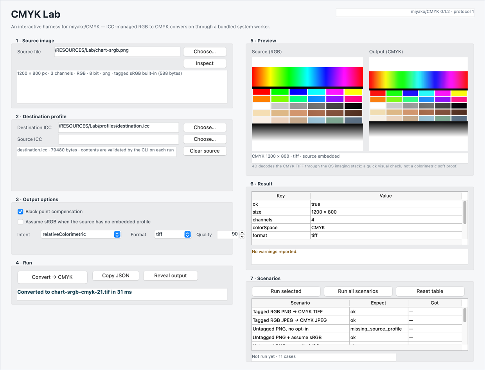
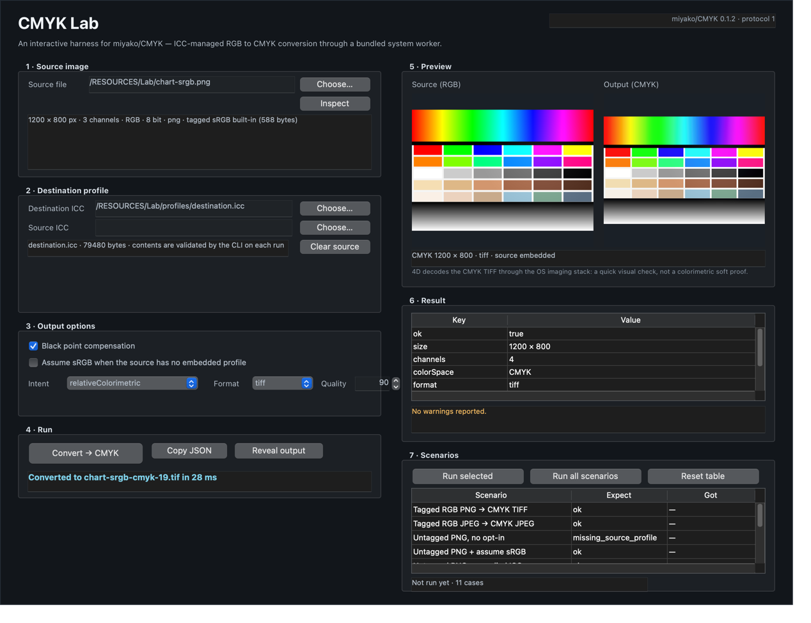

# CMYK-demo

An interactive 4D project that uses [miyako/CMYK](https://github.com/miyako/CMYK)
as a component dependency. It turns ICC-managed RGB → CMYK conversion, which the
component exposes as a system-worker CLI, into something you can poke at: pick a
source image, pick a destination profile, flip the option switches, convert, and
compare the RGB original with the CMYK result. A scenario matrix below the
preview runs eleven conversions that document the component's success and failure
behaviour, including the exact error codes it returns.

The component is pinned to **0.1.2** in `Project/Sources/dependencies.json`, so
the 4D IDE installs it through the Dependency Manager like any other component.
No source from `miyako/CMYK` is copied into this repository.




> The images in `Documentation/` are runtime captures: 4D 21.2 hosts the `Lab`
> form with `DIALOG`, applies `styleSheets.css` for each colour scheme, and
> `FORM SCREENSHOT` saves it after the first conversion has run (see the
> `dialog_screenshot` chain in the `4dcli` skill).

## What it demonstrates

* **The pipeline** — `cs.CMYK.Converter.new(); convertFile(source; destination; options)`
  on a 4D `File`, with `destinationProfile` required and every option wired to a
  real control (`intent`, `blackPointCompensation`, `allowAssumeSRGB`, `format`,
  `quality`, optional `sourceProfile`).
* **The result shapes** — success (`{ok:true; stdout; stderr; exitCode; value}`)
  versus CLI failure (`{ok:false; error:{code:"cli_error"; message:<stderr JSON>}; …}`)
  versus 4D-side `invalid_argument`, each rendered into a key/value listbox and
  shown as compact JSON you can copy from the *Copy JSON* button.
* **The error taxonomy** — `missing_source_profile`, `unsupported_image`,
  `destination_exists`, `read_failed`, `invalid_argument` are not caught and
  swallowed; the scenario matrix asserts each one so a component upgrade that
  changes a code fails loudly.
* **A structural chokepoint** — the component will not overwrite an existing
  destination and will not guess an untagged source's profile. Both are features,
  and both have a scenario.
* **Preview, not proof** — 4D decodes the produced CMYK TIFF for display using a
  generic CMYK→RGB path. That is a visual aid; it is not the conversion accuracy
  of the tool. The demo says so in the UI.

## Requirements

* 4D 20.x or later with the Dependency Manager (the IDE resolves and installs
  `miyako/CMYK` 0.1.2 on first open). Developed against 4D 21R4.
* For the headless acceptance run: free
  [tool4d](https://developer.4d.com/docs/20/Admin/cli) 21R4. This repository was
  tested with `21R4.100224` on macOS arm64.
* The 0.1.2 component ships a macOS arm64 library and macOS/Windows CLI
  binaries. Intel Macs and Windows 4D are **not** covered by this build; see
  `NOTES.md`.

## Run it

1. Open `Project/CMYK-demo.4DProject` in 4D.
2. Let the Dependency Manager install `CMYK` 0.1.2 (Tools → Dependency manager
   shows the component in the project's dependencies; the component ends up in
   `Components/CMYK.4dbase`).
3. Run the project — `On Startup` opens the *CMYK Lab* window.

The left column is the input side: source image, destination profile, optional
source profile, and the conversion options. *Convert* writes
`LabOutput/<name>-cmyk.<ext>` and fills the preview/result panes. The right column
shows the source and output pictures, the decoded result JSON, and the scenario
matrix. *Run all* executes all eleven cases (each writing into `LabOutput/`),
*Run selected* runs the highlighted one.

## Headless acceptance

`tool4d` does not run the Dependency Manager, so stage the released component
first. `scripts/stage_component.py` downloads the pinned `CMYK.zip`, verifies its
SHA256 and installs `Components/CMYK.4dbase` with the Unix modes preserved.

```sh
TOOL4D=/Applications/tool4d/tool4d/21R4/100224/tool4d.app/Contents/MacOS/tool4d \
  scripts/accept.sh /tmp/cmyk-demo-acceptance.json
```

The method `Acceptance` runs the scenario matrix headlessly, then runs the same
`convertCurrent` code path the *Convert* button uses (including decoding the
produced TIFF back into a `Picture`), writes a JSON report and exits with the
number of failures. A passing run looks like:

```
ACCEPTANCE PASS 11 of 11 -> /tmp/cmyk-demo-acceptance.json
```

The form itself needs no window to be validated: `FORM LOAD("Lab")` in `tool4d`
instantiates the form class headlessly, which is how the class/form binding is
smoke-tested. The static checks are cheap and run in CI:

```sh
scripts/verify.sh
```

It validates the form JSON against the 4D form schema (`.agents/schemas`), audits
the geometry against the fixed 1240×946 window for overlaps and overflow, and
cross-checks every `Form.<name>` binding against the class properties.

## Repository layout

| Path | Purpose |
| --- | --- |
| `Project/Sources/Classes/CMYKLab.4dm` | form class: state, conversion calls, scenario matrix |
| `Project/Sources/Forms/Lab/` | form JSON, form method, object methods |
| `Project/Sources/Methods/Start.4dm` | opens the single window |
| `Project/Sources/Methods/Acceptance.4dm` | headless matrix + JSON report, exit code = failures |
| `Project/Sources/DatabaseMethods/onStartup.4dm` | calls `Start` when launched normally |
| `Project/Sources/styleSheets.css` | global styles, dark-mode overrides |
| `Resources/Lab/` | deterministic synthetic test images and ICC profiles |
| `scripts/generate_assets.py` | regenerates `Resources/Lab/` (numpy + Pillow) |
| `scripts/stage_component.py` | stages the pinned component for `tool4d` |
| `scripts/verify.sh`, `scripts/accept.sh` | static and runtime gates |
| `.agents/` | [miyako/skills](https://github.com/miyako/skills) conventions (git submodule) |

`Components/`, `LabOutput/`, `DerivedData/` and `tools/` are generated and
ignored; `tools/` holds the binaries provisioned per the `4dtools` skill.

## Licence

MIT — see `LICENSE`. The test images and ICC profiles under `Resources/Lab/` are
generated by `scripts/generate_assets.py` (the profiles are the component's own
MIT-licensed fixtures, copied, not downloaded).
